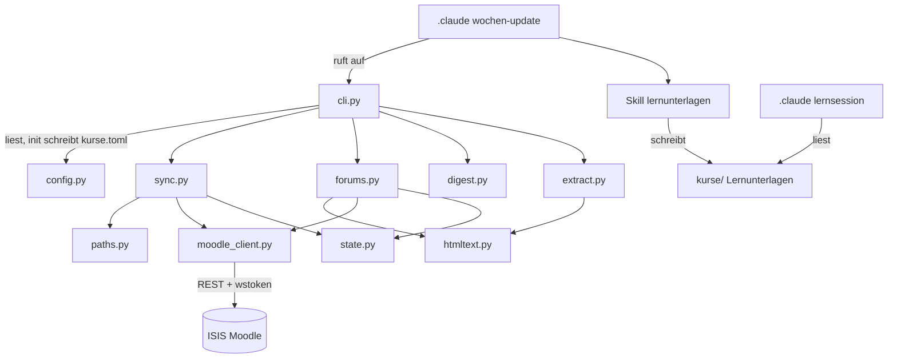
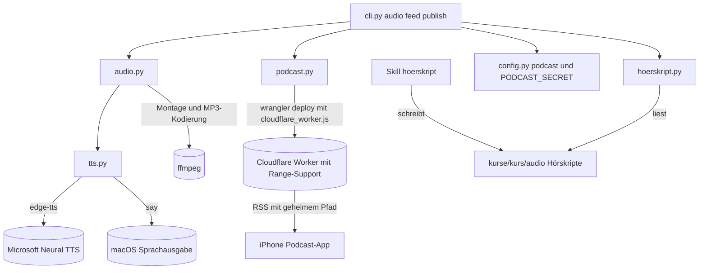
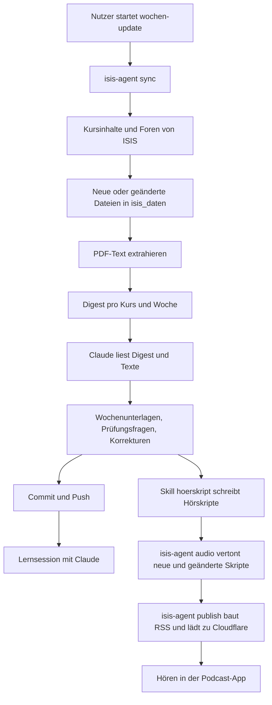
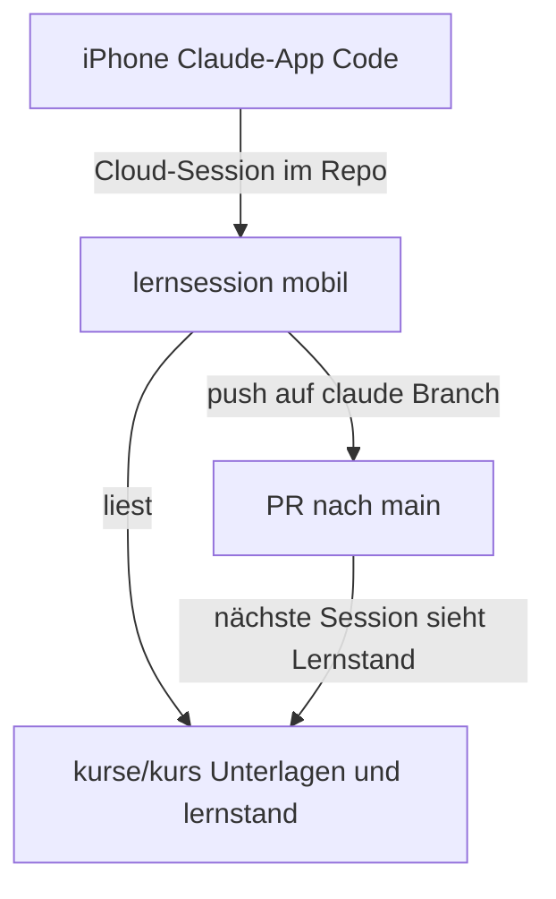

# Architecture — isis-study-agent

> Living document. Update when adding modules/services, changing data flows, or refactoring responsibilities.

## Module Dependency Graph

## Audio & Podcast Modules

## Core Data Flow

## Mobile Lernsession

